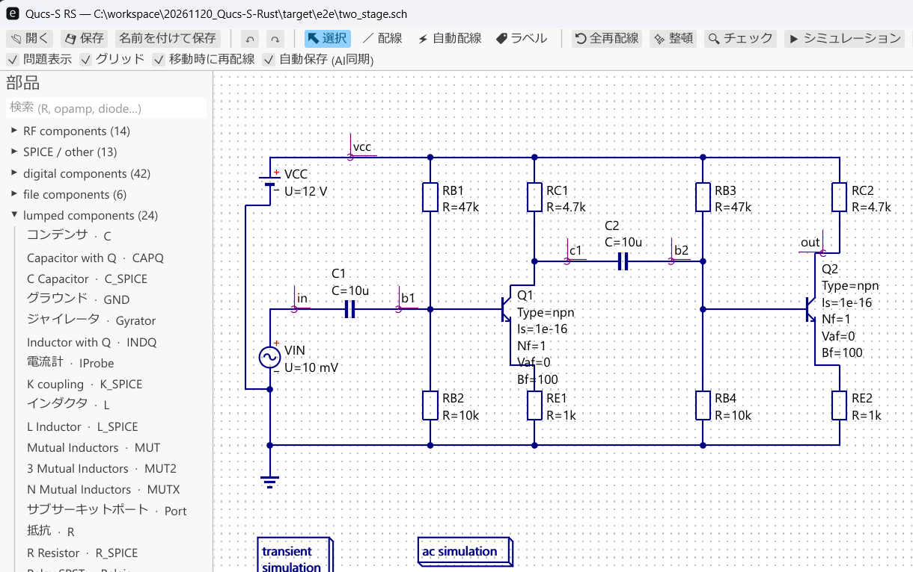

# qucs-s-rs

**A lightweight Rust fork of the Qucs-S schematic editor, with a built-in MCP server for AI agents**

[日本語 README](README.md) · [MCP tool reference](docs/mcp-tools.md) · [Changelog](CHANGELOG.md)

AI agents that draw schematics tend to produce spaghetti: they do not see what the editor really shows, and
they route wires by hand. qucs-s-rs rebuilds the editor in Rust so that

* the agent's `snapshot` is **the very picture the editor draws** (one scene renderer for both),
* component symbols are **extracted from the Qucs-S C++ sources** (lines, arcs, text and pin positions identical to Qucs-S),
* wiring is done by a **net-aware A\* router** that keeps schematics readable (no foreign-net overlaps, few bends, no crossings where avoidable).

Files are plain Qucs-S `.sch`, so everything opens in Qucs-S too.



## Requirements

* Windows 11 (Linux and macOS build and pass CI; CJK UI fonts are picked up from Noto CJK / Hiragino when present)
* Rust 1.94+ (to build)
* For simulation: [ngspice](https://ngspice.sourceforge.io/) — found in `C:\Spice64\bin` or on `PATH`, else set `NGSPICE_PATH`
* [Qucs-S](https://ra3xdh.github.io/) is **optional**: the built-in netlister writes the ngspice netlist; Qucs-S is only used
  for parts and analyses it cannot translate (parameter sweeps, Qucs `Eqn`, HB, noise, Verilog-A, `Lib` parts, ...). Set `QUCS_S_PATH` if it is not found.

### Built-in netlister

A port of Qucs-S' own `spice_netlist()` rules; its output matches `qucs-s -n --ngspice`
(`tests/netlist_parity.py` simulates the same schematics both ways and compares every vector).

* Analyses: `.TR` (lin), `.AC` (lin/log), `.DC` (operating point), `NutmegEq` (`let`), `SpicePar` (`.PARAM`)
* Parts: R/L/C, GND, DC/AC/pulse/rect sources, diode, BJT, MOSFET, JFET, op-amp, VCVS/VCCS/CCVS/CCCS, current and voltage probes,
  B-sources (`S4Q_Ieqndef`, `src_eqndef`, `S4Q_V`, `S4Q_I`), subcircuits (`Sub` + `Port`, nested)
* `QUCS_RS_NETLISTER=auto` (default) | `builtin` | `qucs-s`; MCP `get_component_type` reports `builtin_netlist`

## Build and install

```powershell
cargo build --release                                             # target\release\qucs-s-rs.exe (single file, ~10 MB)
powershell -ExecutionPolicy Bypass -File tools\install.ps1        # per user: %LOCALAPPDATA%\Programs\qucs-s-rs + Start menu
powershell -ExecutionPolicy Bypass -File tools\install.ps1 -Associate   # also "Open with" for .sch files
powershell -ExecutionPolicy Bypass -File tools\uninstall.ps1      # remove (-Purge also deletes settings)
powershell -ExecutionPolicy Bypass -File tools\package.ps1        # release zip in dist\
```

## Editor

```powershell
qucs-s-rs gui examples\inverting_amp.sch
```

* Parts palette (220 built-in types + ~4,200 parts from the 70 Qucs-S libraries) on the left, properties on the right
* Mouse wheel / `Ctrl +/-` zoom, middle/right drag pans, drag moves parts (wires are re-routed), `R` rotate, `M` mirror, `Del`,
  `W` wire, `A` auto-wire two pins, `L` net label, `F` / `Ctrl+0` fit, `Ctrl+Z/Y`, `Ctrl+S` / `Ctrl+Shift+S`, `Ctrl+F` find,
  `Ctrl+P` print, `F5` simulate, `F1` about
* Closing a tab or the window with unsaved changes asks *Save / Don't save / Cancel*
* Settings (view toggles, auto-save, window geometry, panel widths) and the **recent files** menu persist in `%APPDATA%\qucs-s-rs\settings.json`
* **⚡ Operating point**: DC voltages of every net as tags on the schematic, plus source/probe currents; cleared when you edit
* **Hierarchy**: select parts → *Edit → Create subcircuit…* moves them into a new `.sch` (one `Port` per net that leaves the selection)
  and puts a wired `Sub` in their place; double-click a `Sub` to open it
* Export PNG / SVG / PDF (A4); printing opens the PDF in the system viewer
* Results: rectangular (AC in dB + phase), polar, Smith, table, markers, sweep overlays; Monte Carlo, filter / attenuator /
  transmission-line design, parameter sweep and live tuning
* **Auto-save (AI sync)**: edits are written immediately and picked up by the MCP server, and agent edits show up live

## MCP server

```powershell
claude mcp add -s user qucs-s-rs -- cmd /c C:\path\to\qucs-s-rs\tools\qucs-s-rs-mcp.cmd
```

The launcher runs a copy of the release build, so `cargo build --release` works while the server is running.
`QUCS_MCP_WORKDIR` sets where relative `new_schematic` paths go (default `./qucs_work/`).

39 tools — files, components, wiring (`connect` routes whole nets), drawings, `snapshot` / `check_layout`,
hierarchy (`create_subcircuit`, `open_subcircuit`), simulation (`run_simulation`, `dc_operating_point`, `get_results`,
`plot_results`, `run_monte_carlo`, sweeps), RF design tools and live-editor integration. See [docs/mcp-tools.md](docs/mcp-tools.md).

Coordinates are Qucs units (x right, **y down**, 10-unit grid); terminals `"R1.1"`, `"V1.+"`, `"OP1.OUT"`, `"[x,y]"`, `"net:vcc"`.

## CLI

```powershell
qucs-s-rs render in.sch out.png [--overlay] [--pins] [--scale 2]
qucs-s-rs check in.sch
qucs-s-rs reroute in.sch [out.sch]
qucs-s-rs netlist in.sch [--qucs-s]
qucs-s-rs simulate in.sch
qucs-s-rs op in.sch
qucs-s-rs --version
```

## Tests

```powershell
cargo test                       # parser, connectivity rules, editing + undo, router, netlister, hierarchy, PDF, settings
python tests\e2e_mcp.py          # drive the MCP server end to end
python tests\netlist_parity.py   # built-in netlister vs qucs-s (needs Qucs-S + ngspice)
python tests\live_sync.py        # editor follows MCP edits
python tests\e2e_mc.py           # Monte Carlo
python tests\e2e_features.py     # library parts, filter synthesis, markers, sweeps, edit tools
```

`QUCS_RS_SHOT=out.png` (with `QUCS_RS_SHOT_ACTIONS=op,find:R1,about,quit`) makes the editor save a screenshot of
itself and exit — handy for checking the GUI headlessly. CI runs clippy, tests and builds on Windows, Linux and macOS,
and simulates the examples with ngspice on Linux using only the built-in netlister.

## License

The symbols are ported from Qucs-S (GPL-2.0-or-later), so this project is **GPL-2.0-or-later** as well ([LICENSE](LICENSE)).
