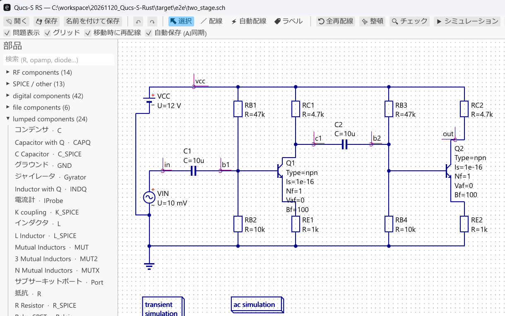
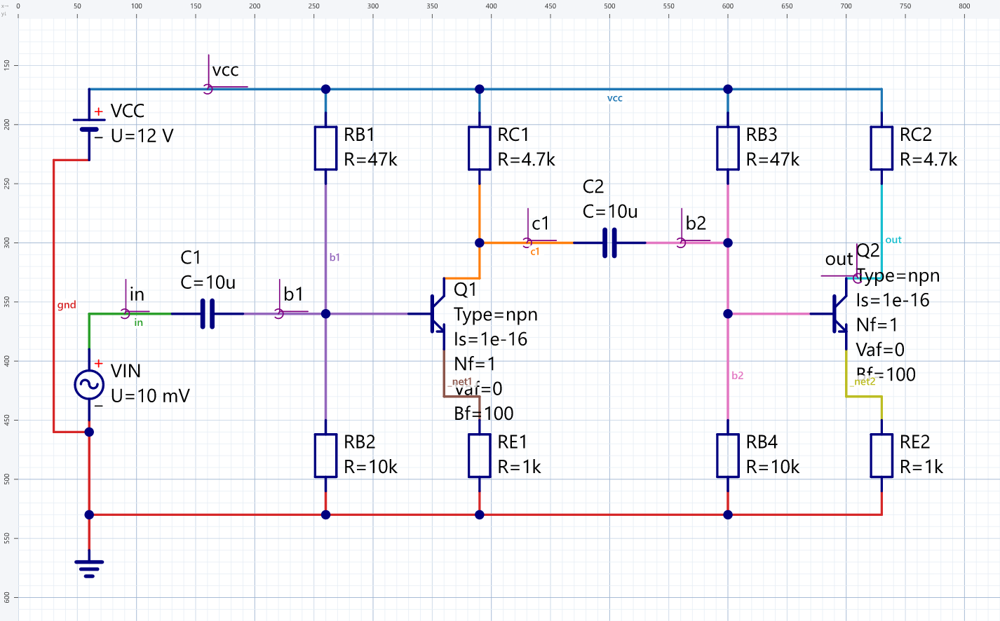

# qucs-s-rs

**Qucs-S の Rust 製フォーク（軽量回路図エディタ）＋ AI エージェント用 MCP サーバー**

[English README](README.en.md) ・ [MCP ツールリファレンス](docs/mcp-tools.md) ・ [変更履歴](CHANGELOG.md)

Python 版 [qucs-s-mcp](../20261119_Qucs-S-mcp) では「AI が見ている画像」と「Qucs-S の実際の描画」が別物で、
配線もエージェント任せだったため、回路図がスパゲッティになりがちでした。qucs-s-rs はエディタ本体を Rust で作り直し、

* **エディタが描く絵そのもの**（同じシーン描画コード）を MCP の `snapshot` で AI に渡す
* 部品シンボルは **Qucs-S の C++ ソースから自動抽出**（線・円弧・文字・ピン位置まで本家と同一）
* 配線は **ネットを意識した A\* オートルーター**が担当し、回路図として読みやすい形を保証する

という構成にしています。保存形式は Qucs-S の `.sch` そのままなので、いつでも本家 Qucs-S で開けます。



## スパゲッティ対策

| 原因 | 対策 |
|---|---|
| 回転後どちらにピンが来るか AI が分からず、配線が部品を回り込む | `connect` 前に R/C/L を自動で 180° 反転（ピンスワップ）。`add_components` は全ピンの絶対座標と引き出し方向を返す |
| 配線が他ネットに重なる・ピンの上を通る（見た目は接続、実際は非接続） | ルーターが他ネットとの重なり／他ネットのピン・端点への接触／他配線途中での折れを禁止 |
| 折れ・交差だらけ | 折れ・交差・部品への接近・文字への重なりにコスト。短いネットから配線し、引き剥がし再配線で改善 |
| ピンが配線の途中に乗っているだけで未接続 | T 字分岐は自動で配線を分割（Qucs は端点でしか接続しない）。`check_layout` が検出 |
| AI が見ている画像と実物が違う | エディタと MCP が同じ描画コード。フォント寸法（16 px / 行送り 21）も本家に合わせ済み |

2 段トランジスタ増幅器（15 部品・9 ネット）を MCP から組んだ例: 総配線長 3160、折れ 11、**交差 0**。



## 必要環境

* Windows 11（Linux / macOS でもビルド・CI 済み。日本語フォントは Noto CJK / ヒラギノ等を自動検出）
* Rust 1.94 以上（ビルド時のみ）
* シミュレーションを使う場合: [ngspice](https://ngspice.sourceforge.io/)  
  既定の場所（`C:\Spice64\bin`）か PATH から自動検出。別の場所なら `NGSPICE_PATH`
* [Qucs-S](https://ra3xdh.github.io/) は**任意**。ネットリストは内蔵のネットリスタが生成し、内蔵で扱えない部品・解析
  （パラメータスイープ、Qucs の `Eqn`、HB、ノイズ、Verilog-A、Lib 部品など）があるときだけ Qucs-S を使います（`QUCS_S_PATH`）

描画・編集・配線・チェック・TR/AC/DC シミュレーションは Qucs-S 無しで動きます。

### 内蔵ネットリスタ

Qucs-S の `spice_netlist()` と同じ変換規則を Rust に移植したもので、出力は `qucs-s -n --ngspice` と同等です
（`tests/netlist_parity.py` で両者のシミュレーション結果が一致することを確認）。

* 解析: `.TR`（lin）、`.AC`（lin / log）、`.DC`（動作点）、`NutmegEq`（`let` 式）、`SpicePar`（`.PARAM`）
* 部品: R / L / C、GND、Vdc / Idc / Vac / Iac / Vpulse / Ipulse / Vrect / Irect、ダイオード、BJT、MOSFET、JFET、
  オペアンプ、VCVS / VCCS / CCVS / CCCS、電流・電圧プローブ、B ソース（`S4Q_Ieqndef` / `src_eqndef` / `S4Q_V` / `S4Q_I`）、
  サブ回路（`Sub` + `Port`、入れ子可）
* 切り替え: `QUCS_RS_NETLISTER=auto`（既定）/ `builtin` / `qucs-s`。MCP の `get_component_type` は `builtin_netlist` で対応可否を返す

## ビルド

```powershell
cargo build --release
```

`target\release\qucs-s-rs.exe`（単一ファイル、約 10 MB、アイコン・バージョン情報入り）ができます。

### インストール（ユーザー単位・管理者権限不要）

```powershell
powershell -ExecutionPolicy Bypass -File tools\install.ps1             # %LOCALAPPDATA%\Programs\qucs-s-rs とスタートメニュー
powershell -ExecutionPolicy Bypass -File tools\install.ps1 -Associate  # .sch の「プログラムから開く」にも登録
powershell -ExecutionPolicy Bypass -File tools\uninstall.ps1           # 削除（-Purge で設定も削除）
powershell -ExecutionPolicy Bypass -File tools\package.ps1             # 配布用 zip を dist\ に作成
```

## 使い方

### エディタ

```powershell
.\target\release\qucs-s-rs.exe gui examples\inverting_amp.sch
```

* 左: 部品パレット（検索可）、右: プロパティ編集、上: ツールバー
* 操作: ホイール・`Ctrl +/-` でズーム、中／右ドラッグでパン、ドラッグで移動（移動後に自動再配線）、`R` 回転、`M` ミラー、`Del` 削除、`W` 手配線、`A` 自動配線（ピンを 2 つクリック）、`L` ネットラベル、`F` / `Ctrl+0` 全体表示、`Ctrl+Z / Ctrl+Y`、`Ctrl+S` 保存 / `Ctrl+Shift+S` 名前を付けて保存、`Ctrl+F` 検索（部品名・種類・値・ネット名）、`Ctrl+P` 印刷、`F5` シミュレーション、`F1` バージョン情報
* 未保存の変更があるタブやウィンドウを閉じると「保存 / 保存しない / キャンセル」を確認（自動保存 OFF のときや無題の回路図）
* 設定（表示の切り替え、自動保存、ウィンドウ位置・サイズ、パネル幅）と「🕘 最近」のファイル履歴は `%APPDATA%\qucs-s-rs\settings.json` に保存
* ⚡ 動作点: DC 動作点を計算し、各ネットの電圧を回路図上にタグ表示（電源・プローブの電流も一覧）。回路を編集すると自動で消える
* 階層設計: 部品を選んで「✂ 編集 → サブ回路を作成…」で、選択部分を新しい .sch（外へつながるネットごとに Port）へ移し、`Sub` 部品で置き換えて配線し直す。`Sub` をダブルクリック（またはプロパティの「⤵ サブ回路を開く」）で中を開く
* 🖼 書き出し: PNG / SVG / PDF（A4）。印刷は PDF を既定のビューアで開いて行う
* 「自動保存 (AI同期)」（既定 OFF）を ON にすると、MCP 側（AI）は保存された編集を次のツール呼び出しで読み込みます。エディタ側に未保存の変更があるときは、外部版と編集中の版を確認し、編集中の回路図を別ファイルに残してから外部版を取り込めます。
* 「チェック」でエラーと警告を確認できます。項目を選択すると回路図の該当箇所に移動し、修正のヒントが表示されます。
* 部品パレットで日本語名・英語名・型番を検索できます。「部品」（220 種の組み込み部品）と「ライブラリ」（Qucs-S 付属の 70 ライブラリ・約 4,200 の実部品）の部品は「よく使う」に登録できます。
* 編集: `Ctrl+C / X / V`（Qucs のクリップボード形式なので Qucs-S との間でもコピーできる）、`Ctrl+D` 複製、`Ctrl+A` 全選択、`Y` Y 軸ミラー、`T` テキスト、図形（線・矩形・楕円・矢印）、整列・等間隔配置、ラベルや図形のドラッグ移動、選択肢のあるプロパティはプルダウン、PNG / SVG 書き出し
* 結果は回路図と並べて表示できます。回路図を編集すると前回の結果に再実行が必要と表示されます。再実行時は解析・信号の選択を引き継ぎ、対応する直交グラフでは前回の波形と重ねて比較できます。直交（AC は dB＋位相）・極座標・スミスチャート・表、マーカー、パラメータスイープに対応します。
* 実行には ngspice と解析設定が必要です。無題の回路図は名前を付けて保存できます。保存済みの回路図を編集してから実行すると、編集内容を一時ファイルで解析できます。
* タブ: 複数の回路図をタブで開ける（`Ctrl+T` 新規 / `Ctrl+W` 閉じる / `Ctrl+Tab` 切替 / `Ctrl+O` 開く）。エディタは 1 ウィンドウで、2 つ目の起動や MCP の `open_gui` は既存ウィンドウのタブとして開く
* ⚙ ツール: モンテカルロ解析（R/C/L の許容差、正規/一様分布、測定点の統計と重ね描き。ngspice を並列実行）、フィルタ設計（Butterworth / Chebyshev / Bessel、LP / HP / BP / BS、テスト回路付きで配置）、減衰器設計（π / T / ブリッジ T）、伝送線路計算（マイクロストリップの解析・合成、同軸）、パラメータスイープ、チューニング（スライダーで値を変えると自動で再シミュレーション）

### MCP サーバー（Claude Code）

サーバーは `tools\qucs-s-rs-mcp.cmd` から起動します。このランチャーは release ビルドを
`%LOCALAPPDATA%\qucs-s-rs\mcp-bin\` にコピーしてから実行するので、サーバーが動いていても
`target\release\qucs-s-rs.exe` はロックされず、`cargo build --release` でいつでも上書きできます
（新しいビルドは次に起動したサーバーから使われます。使われなくなったコピーは次回起動時に削除）。

このフォルダの `.mcp.json`:

```json
{
  "mcpServers": {
    "qucs-s-rs": { "command": "cmd", "args": ["/c", "tools\\qucs-s-rs-mcp.cmd"] }
  }
}
```

別のプロジェクトから使う場合（先に release ビルドが必要。Git Bash では `/c` がパスに変換されるので PowerShell で実行）:

```powershell
claude mcp add -s user qucs-s-rs -- cmd /c C:\workspace\20261120_Qucs-S-Rust\tools\qucs-s-rs-mcp.cmd
```

Claude Desktop など:

```json
{
  "mcpServers": {
    "qucs-s-rs": {
      "command": "cmd",
      "args": ["/c", "C:\\workspace\\20261120_Qucs-S-Rust\\tools\\qucs-s-rs-mcp.cmd"],
      "env": { "QUCS_MCP_WORKDIR": "C:\\path\\to\\schematics" }
    }
  }
}
```

`QUCS_MCP_WORKDIR` は相対パスで `new_schematic` したときの保存先（既定: カレントの `qucs_work/`）。

## MCP ツール

| 分類 | ツール |
|---|---|
| ファイル | `new_schematic` `open_schematic` `save_schematic` `get_schematic` `export_image`（PNG / SVG） |
| 部品 | `list_component_types` `get_component_type` `search_library`（Qucs-S ライブラリの実部品） `add_components`（`type:"Lib"` + `lib`/`comp` で実部品、`align` でピン基準配置） `update_component`（`mirror_y` も可） `move_components`（自動再配線） `duplicate_components` `align_components` `delete_components` |
| 配線 | `connect`（複数ネットを一括、ラベル付与、ピンスワップ、改善パス） `add_wire` `delete_wires` `add_net_label` `reroute` `tidy` |
| 図形 | `add_painting`（線・矩形・楕円・矢印・テキスト） `delete_paintings` |
| 見る | `snapshot`（PNG。グリッド＋座標ルーラー、ネット色分けと名前、ピン名、問題マーカー、ハイライト、領域ズーム、`clean` で報告用） `check_layout` |
| 階層 | `create_subcircuit`（部品をサブ回路ファイルへ移し Sub で置換、ポートを自動生成） `open_subcircuit`（Sub の中へ） |
| シミュレーション | `add_simulation` `add_parameter_sweep` `run_monte_carlo`（部品値のばらつき、統計・歩留まり・重ね描き・ヒストグラム） `get_netlist`（`netlister` 指定可） `run_simulation` `dc_operating_point`（全ネット電圧・枝電流） `get_results`（指定点の補間値・表） `plot_results`（直交・極座標・スミス・表、マーカー値を数値でも返す） |
| 設計ツール | `design_filter`（LC フィルタ合成→配置・配線、テスト回路付き） `design_attenuator` `calc_transmission_line`（マイクロストリップ / 同軸） |
| エディタ連携 | `open_gui`（ユーザーにライブ表示） `get_gui_state`（ユーザーが選択中の部品・表示範囲） |

全ツールの引数は [docs/mcp-tools.md](docs/mcp-tools.md)（`python tools\gen_mcp_docs.py` でサーバーから再生成）。

座標は Qucs と同じ（x 右、**y 下**、10 グリッド）。端子指定は `"R1.1"` `"V1.+"` `"OP1.OUT"`、座標 `"[x,y]"`、ネット `"net:vcc"`。

推奨フロー: `new_schematic` → `add_components` → `connect`（全ネットを 1 回で） → `snapshot` で確認 → `check_layout` → `move_components` / `reroute` / `tidy` → `add_simulation` → `run_simulation` → `plot_results`。

### CLI

```powershell
qucs-s-rs render in.sch out.png [--overlay] [--pins] [--scale 2]   # PNG / SVG 出力
qucs-s-rs check in.sch                                              # レイアウト検査 (JSON)
qucs-s-rs reroute in.sch [out.sch]                                  # 全ネット再配線
qucs-s-rs netlist in.sch [--qucs-s]                                 # ngspice ネットリスト
qucs-s-rs simulate in.sch                                           # シミュレーション (JSON 要約)
qucs-s-rs op in.sch                                                 # DC 動作点 (JSON)
qucs-s-rs --version
```

## 構成

```
src/
  schematic.rs  .sch の読み書き（未対応セクションはそのまま保持）
  library.rs    部品 DB とシンボル配置（Qucs の mirror→rotate 規則を移植）
  netlist.rs    接続解析（端点のみ接続、同名ラベル・GND の結合、物理的な島）
  router.rs     ネット対応 A* 直交ルーター
  doc.rs        編集操作（配置、connect、ピンスワップ、再配線、ラベル配置、整頓）
  check.rs      レイアウト検査とメトリクス
  render.rs     共通シーン → egui / SVG / PNG(resvg)
  gui.rs        エディタ (egui)
  mcp.rs        MCP サーバー (stdio JSON-RPC)
  sim.rs        ネットリスト（内蔵 / qucs-s） → ngspice → raw 解析、DC 動作点
  spice.rs      内蔵ネットリスタ（Qucs-S の変換規則を移植、サブ回路対応）
  hier.rs       階層設計（選択からサブ回路を作成、Sub のファイル解決）
  settings.rs   設定と最近使ったファイル
  pdf.rs        PDF 書き出し・印刷
  diagram.rs    結果ダイアグラム（直交・極座標・スミス・表、マーカー）
  qlib.rs       Qucs-S ライブラリ（.lib）とサブ回路の <Symbol> 読み込み
  edit.rs       クリップボード、複製、整列、図形
  rftools.rs    フィルタ・減衰器・伝送線路の計算
  synth.rs      計算結果を回路図に配置・配線（テスト回路付き）
  montecarlo.rs モンテカルロ解析（ネットリストの値を揺らして ngspice を並列実行）
  plot.rs       数値の表記
data/
  components.json  プロパティ・ピン（qucs-s から実測）
  symbols.json     シンボル図形（tools/extract_symbols.py が Qucs-S の C++ から生成）
```

シンボルの再生成（Qucs-S を更新したとき）:

```powershell
git clone --depth 1 https://github.com/ra3xdh/qucs_s.git ..\qucs_s_src_ref\qucs_s
python tools\extract_symbols.py ..\qucs_s_src_ref\qucs_s data\components.json data\symbols.json
```

219/220 種のシンボルを抽出、ピン位置は 216 種で Qucs-S の実測値と一致（残りはサブ回路など動的な部品で、汎用の箱シンボルで描画）。

## テスト

```powershell
cargo test                                # パーサ往復、接続規則、編集と Undo、ルーター、内蔵ネットリスタ、サブ回路、PDF、設定
python tests\netlist_parity.py            # 内蔵ネットリスタと qucs-s の結果が一致するか（Qucs-S と ngspice が必要）
python tests\e2e_mcp.py                   # MCP クライアントとして回路作成〜シミュレーションまで
python tests\live_sync.py                 # エディタを開いたまま MCP で編集し、追従を確認
python tests\e2e_mc.py                   # モンテカルロ解析
python tests\e2e_features.py             # ライブラリ部品・フィルタ合成・マーカー・スイープ・編集ツール
```

GUI の確認用に、`QUCS_RS_SHOT=out.png`（と `QUCS_RS_SHOT_ACTIONS=op,find:R1,about,quit`）を付けて起動すると、
その状態のウィンドウを PNG に保存して終了します。CI（GitHub Actions）は Windows / Linux / macOS で clippy・テスト・ビルドと、
Linux の ngspice で内蔵ネットリスタによるシミュレーションを実行します。

## ライセンス

Qucs-S（GPL-2.0-or-later）のシンボル定義を移植しているため、本プロジェクトも **GPL-2.0-or-later** です（[LICENSE](LICENSE)）。
